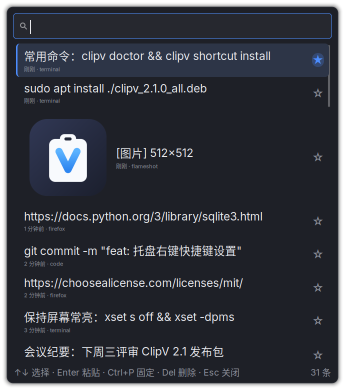
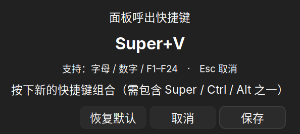
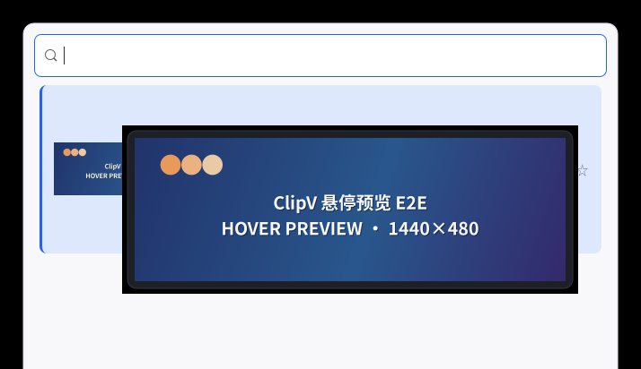

<p align="center">
  
</p>

<h1 align="center">ClipV</h1>

<p align="center">
  Linux 桌面剪贴板历史管理器 —— 类 Windows <code>Win+V</code> 体验
</p>

<p align="center">
  
  
  
</p>

ClipV 常驻后台自动记录剪贴板历史（**文本 + 图片**），按 `Super+V` 呼出历史面板：
实时搜索、固定收藏、一键回贴（可选自动粘贴回原窗口）。纯本地存储、不联网，
deb 安装包约 48 KB（GTK3 系统原生依赖，无 venv、无 Qt 运行时）。

| 历史面板 | 快捷键设置（托盘右键） |
| :---: | :---: |
|  |  |

| 图片悬停预览（鼠标停留缩略图自动放大） |
| :---: |
|  |

## 功能特性

- **文本 + 图片**：自动捕获文本、截图与图像数据；内容哈希去重、全局去重置顶
- **图片悬停预览**：鼠标停留在缩略图上自动弹出放大预览（最大 480×360、等比缩放不放大超过原图），快速扫过不打扰
- **全局呼出**：`Super+V` 呼出/隐藏面板；托盘右键「设置快捷键…」图形化改键，立即生效
- **实时搜索**：关键词即时过滤、命中高亮；`↑`/`↓` 选择、`Enter` 回贴、`Esc` 关闭
- **回贴即粘贴**（可选）：选中后自动激活原窗口并注入 `Ctrl+V`，真正的 `Win+V` 体验
- **固定与清理**：固定条目置顶；清空需同键二次确认；条数上限与单条大小可配
- **隐私安全**：数据仅存本地 SQLite（无任何网络代码）；默认忽略常见密码管理器；日志不记录剪贴板内容
- **轻量**：GTK3 / PyGObject 走发行版系统包；deb 约 48 KB（对比自包含 Qt 方案约 600 MB）
- **托盘常驻**：AppIndicator 图标；左键呼出面板，右键菜单可设置快捷键、查看「关于」与退出

## 安装

### 方式一：deb 安装包（推荐）

适用于 Debian / Ubuntu / Linux Mint 等发行版。从 [Releases](../../releases) 下载
`clipv_<版本>_all.deb`，然后：

```bash
sudo apt install ./clipv_2.1.0_all.deb    # 在 deb 所在目录执行；文件名随版本变化
```

系统依赖（`python3`、`python3-gi`、`gir1.2-gtk-3.0`、`python3-gi-cairo`、`python3-xlib`）
由 apt 自动解析安装。卸载：`sudo apt remove clipv`（配置与历史数据保留）。

### 方式二：源码运行（开发）

```bash
git clone https://github.com/ArvinLiubaby/ClipV.git
cd ClipV
./install.sh          # 检查系统 GTK 依赖，生成 ~/.local/bin/clipv 入口
```

## 快速开始

```bash
clipv doctor              # 环境与能力诊断（会话类型、依赖、降级提示）
clipv shortcut install    # 绑定全局快捷键（默认 Super+V，自动处理冲突）
clipv autostart enable    # 登录后自动启动
clipv                     # 手动呼出面板
```

之后按 `Super+V`（或托盘左键）呼出面板；想换键可右键托盘图标 →
「设置快捷键…」，按下新组合键即时生效。

## 快捷键

| 操作 | 默认快捷键 | 可配置 |
| :--- | :--- | :---: |
| 呼出/隐藏面板 | `Super+V` | ✅ |
| 上一条 / 下一条 | `↑` / `↓` | — |
| 确认回贴 | `Enter` | — |
| 关闭面板 | `Esc` | — |
| 固定/取消固定 | `Ctrl+P` | ✅ |
| 删除当前条目 | `Delete` | ✅ |
| 清空非固定历史 | `Ctrl+Shift+Delete` | ✅ |

## 常用命令

| 命令 | 功能 |
| :--- | :--- |
| `clipv` / `clipv toggle` | 呼出/隐藏面板（守护进程未运行自动拉起） |
| `clipv list [-n N] [--query Q] [--json]` | 列出历史记录（不依赖守护进程） |
| `clipv add [文本]` | 新增一条历史（无参数读 stdin），供脚本集成 |
| `clipv clear [--all]` | 清空非固定历史；`--all` 含固定条目（二次确认） |
| `clipv config show/set/get/reset` | 查看或修改配置 |
| `clipv shortcut install/remove/edit` | 绑定/解绑/图形化设置全局快捷键 |
| `clipv about` | 打开关于对话框（版本 / 仓库地址 / 许可） |
| `clipv autostart enable/disable` | 登录自启动（XDG autostart） |
| `clipv daemon [--detached]` / `clipv stop` | 启动/停止守护进程 |
| `clipv doctor` | 环境与能力诊断 |
| `clipv version` | 版本信息 |

## 配置

配置文件：`~/.config/clipv/config.json`（`clipv config edit` 打开编辑）。

| 配置项 | 默认值 | 说明 |
| :--- | :--- | :--- |
| `hotkey.toggle` | `Super+V` | 呼出热键（建议用图形化设置修改） |
| `history.max_items` | `100` | 非固定历史条数上限 |
| `paste.auto_paste` | `false` | 选中后是否自动注入 `Ctrl+V` 粘贴 |
| `ignore.apps` | 常见密码管理器 | 忽略的应用（WM_CLASS，仅 X11） |
| `storage.path` | 空（默认） | 历史数据库路径 |
| `ui.theme` | `auto` | `auto` / `dark` / `light` |

## 平台支持

| 能力 | X11 | Wayland |
| :--- | :--- | :--- |
| 剪贴板监听 | ✅ | ✅ 需 `wl-paste`，否则降级提示 |
| 全局热键 | ✅ 守护进程自主注册 | ⚠️ 需桌面环境绑定 `clipv toggle` |
| 自动粘贴 | ✅ 内置 XTest，无需外部工具 | ⚠️ 需 `ydotool` / `wtype` |
| 来源应用识别 | ✅ | ❌ 显示"未知"（安全模型限制） |
| 面板精确定位 | ✅ 鼠标所在显示器居中 | ⚠️ 由合成器决定 |

`clipv doctor` 会报告当前会话的实际能力与降级建议。

## 从源码构建

```bash
packaging/build_deb.sh                              # 构建 deb → dist/clipv_<版本>_all.deb
python3 -m unittest discover -s tests -v            # 运行测试（GTK 用例需图形会话）
```

## 设计文档

架构组件、降级矩阵、目录结构与关键交互时序详见 [docs/design.md](docs/design.md)。

## 许可

本项目采用 [MIT License](LICENSE) 开源。

- 任意用途（含商业使用）、修改、分发、再许可与私人使用
- 唯一要求：在副本中保留版权声明与许可声明
